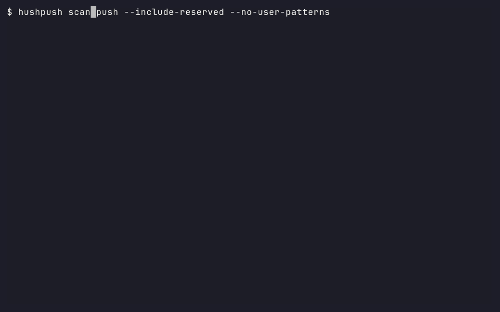

# hushpush



**A local, offline privacy check for logs and screenshots before a Git push.**

## What hushpush is / is not

hushpush finds likely personal data, shows masked findings, and makes redacted
copies you review and stage yourself. It complements a secret scanner such as
[Betterleaks](https://github.com/betterleaks/betterleaks) or
[gitleaks](https://github.com/gitleaks/gitleaks). It cannot certify publication:
“No findings in supported categories” still needs your review.

**Pre-alpha:** release acceptance and further detectors remain in progress.
No release or tag exists yet. Renamed from LeakLens on 2026-10-27.

## Install and quickstart

Prerequisites: Windows 10 1903+ with the
[Visual C++ 2015–2022 x64 Redistributable](https://aka.ms/vs/17/release/vc_redist.x64.exe),
or Linux with **glibc ≥2.35**. Without the Windows runtime, the loader reports
missing `MSVCP140.dll` / `VCRUNTIME140.dll` before hushpush can start.
macOS packaging is configured but not locally verified. Git is needed for Git modes.

### 1. Install and check the binary

Public installers, Homebrew and cargo-binstall are **pending the first release**;
there is currently no working public binary-install command. For a pre-release
trial, obtain the owner-built archive for your platform, place it in an empty
trial directory, and unpack it there. Do not clone just to obtain the sample.

Windows PowerShell:

```powershell
Expand-Archive ./hushpush-cli-x86_64-pc-windows-msvc.zip -DestinationPath ./hushpush-bin
$env:PATH = (Resolve-Path ./hushpush-bin).Path + ';' + $env:PATH
hushpush --version
```

Linux x86_64 (POSIX shell):

```sh
mkdir hushpush-bin
tar -xJf hushpush-cli-x86_64-unknown-linux-gnu.tar.xz -C hushpush-bin
export PATH="$PWD/hushpush-bin:$PATH"
hushpush --version
```

Both should exit 0 and show:

```text
hushpush 0.1.0
OCR models embedded (det a431985659dc, rec da72dc72ca4d, dict 1ea296369561)
```

Release builds embed the pinned OCR models and statically link ONNX Runtime;
scanning downloads nothing. See [packaging status](docs/packaging.md) and
[source-build instructions](docs/building.md) for other platforms and model lookup.
Review installer scripts before running them once releases become available.

### 2. Download the synthetic sample

Start with a new `evidence` directory. `mkdir` should succeed; the download
should create one log without printing its contents. This URL is pinned to T14.

Windows PowerShell:

```powershell
mkdir evidence
Invoke-WebRequest https://raw.githubusercontent.com/GerritHoskins/hushpush/624054997bc051264d07ffffd6ea82ba6b2e7652/demo/evidence/synthetic.log -OutFile evidence/synthetic.log
```

Linux / macOS:

```sh
mkdir evidence
curl --proto '=https' --tlsv1.2 -fsSL https://raw.githubusercontent.com/GerritHoskins/hushpush/624054997bc051264d07ffffd6ea82ba6b2e7652/demo/evidence/synthetic.log -o evidence/synthetic.log
```

### 3. Scan it

Same command on both shells:

```sh
hushpush scan dir ./evidence --include-reserved --no-user-patterns
```

Actual Windows and Linux output excerpts (the detector/configuration footer is
omitted here):

```text
synthetic.log:2:7  Warn  Email  High  [EMAIL len=16]
synthetic.log:3:14  Block  PaymentCard  High  [CARD len=19]
Scanned 1 file
```

```text
1 blocking finding, 1 warning finding
```

**Exit 1 is expected:** the sample contains a published sandbox card number.
`--include-reserved` enables reserved `example.com` email data (and fictional
phone numbers); otherwise these are ignored. `--no-user-patterns` keeps this
trial independent of personal patterns. In a Git repository, findings also
include repository-local `fp=…` fingerprints. Nothing prints a detected value.
Check the exit immediately with `$LASTEXITCODE` (PowerShell) or `echo $?` (POSIX).
Measured extraction-to-first-result timings are in the
[T15 validation record](docs/t15-validation.md); public installation remains unverified.

### 4. Make and review a copy

Use a new, empty output directory:

```sh
hushpush redact ./evidence --out ./evidence-redacted --include-reserved --no-user-patterns
```

It repeats the masked findings and exits 0 with:

```text
Wrote 1 redacted copy to ./evidence-redacted; 0 unchanged; 0 not redacted
```

Review `evidence-redacted/synthetic.log` in your editor. For this synthetic
example only, you can use `Get-Content ./evidence-redacted/synthetic.log` on
PowerShell or `cat ./evidence-redacted/synthetic.log` on POSIX. Expect:

```text
Synthetic installation smoke fixture; no real personal data.
email=[REDACTED:EMAIL]
payment_card=[REDACTED:CARD]
```

Rescan the copy:

```sh
hushpush scan dir ./evidence-redacted --include-reserved --no-user-patterns
```

It exits 0 and ends with `No findings in supported categories.` Check for lost
context and unsupported content yourself. Originals are untouched, copies are
rescanned before being kept, and nothing is staged automatically.

In a standalone trial directory, `git init` first.
Inside your intended Git repository, stage only the reviewed copy yourself:

```sh
git add ./evidence-redacted/synthetic.log
```

Expect no output from `git add`; `git diff --cached --stat` should list the reviewed log.
Do not stage the original sample.

### 5. Optional hooks

Print and review the native pre-push hook:

```sh
hushpush hook print
```

This only prints a script. To opt in, save it yourself as `.git/hooks/pre-push`
(or your configured hooks path), preserve any existing hook, and make it
executable on Unix. The native hook scans every ref in a push.

With [pre-commit](https://pre-commit.com), use pre-commit **3.2+** and an installed
`hushpush` on `PATH`. These `language: system` hooks run that binary:

```yaml
repos:
  - repo: https://github.com/GerritHoskins/hushpush
    rev: 624054997bc051264d07ffffd6ea82ba6b2e7652 # existing T14 commit; no release tag yet
    hooks:
      - id: hushpush           # staged index, not working-tree files
      - id: hushpush-pre-push  # first eligible ref only
```

Opt in yourself with `pre-commit install --hook-type pre-commit --hook-type pre-push`.
The adapter validates all six `PRE_COMMIT_*` variables, never reads stdin or
fetches objects, and exits **2** if variables are missing/invalid. pre-commit
[passes only the first eligible ref](https://github.com/pre-commit/pre-commit/blob/main/pre_commit/commands/hook_impl.py)
of a multi-ref push; whole-history pushes can omit FROM/TO and therefore exit
**2**. Use the native hook when every pushed ref must be checked.

## What it checks

`scan dir` reads disk files; `scan staged` reads index bytes, including Git's
temporary commit index. `scan push`, `scan commits A..B`, and the native hook
include new blobs in intermediate commits, even if later removed.
PNG/JPEG screenshots use local PP-OCRv5 mobile OCR with bounding boxes.

Current categories: cards, email, phone, home-path usernames, private PEM,
clipboard records/fields, and external user patterns. See the
[detector reference](docs/detectors.md) for exact formats and defaults.
Supported-content failures default to exit 3; unsupported content warns by
default. Review coverage even after exit 0. See
[reports, exit codes, configuration and allowlists](docs/reference.md).

## Limitations

- **Latin-only OCR:** non-Latin, rotated, stylized and low-resolution image text can be missed.
- No PDF, archives, video, GIF/WebP/BMP/TIFF/HEIC/AVIF scanning.
- National phones without country codes, undocumented clipboard keys, free-form
  names/addresses/messages, split values and most encoded content can be missed.
- Broad secret detection needs a companion scanner.
- Platform prerequisites and pre-commit coverage restrictions above apply.
- A passing rescan covers supported categories; always review the copy.

[Detailed limitations and security boundaries](docs/limitations.md) cover image
limits/orientation, lossy UTF-8, symlinks, LFS, redaction retries, metadata removal,
concurrent-writer risks, and fuzzing. Images receive opaque masks and are
re-encoded as PNG without original metadata; failed/residual copies are discarded.

## Contribute and evaluate

[CONTRIBUTING](CONTRIBUTING.md) has setup, checks, privacy rules and four entry
points: detectors, log recognizers, seeded corpus samples and OCR backends.
[Independent corpus evaluation](docs/evaluation.md) preserves the measured-gate,
baseline and sealed-test guidance. Corpus measurements are not real-world accuracy.

[Outside-tester guide](docs/tester-guide.md) · [Demo reproduction](demo/README.md) ·
[Plan](docs/plan.md) · [Agent rules](AGENTS.md)

## License

[MIT](LICENSE-MIT) OR [Apache-2.0](LICENSE-APACHE), at your option.
OCR models: Apache-2.0 (PaddlePaddle); ONNX Runtime: MIT.
